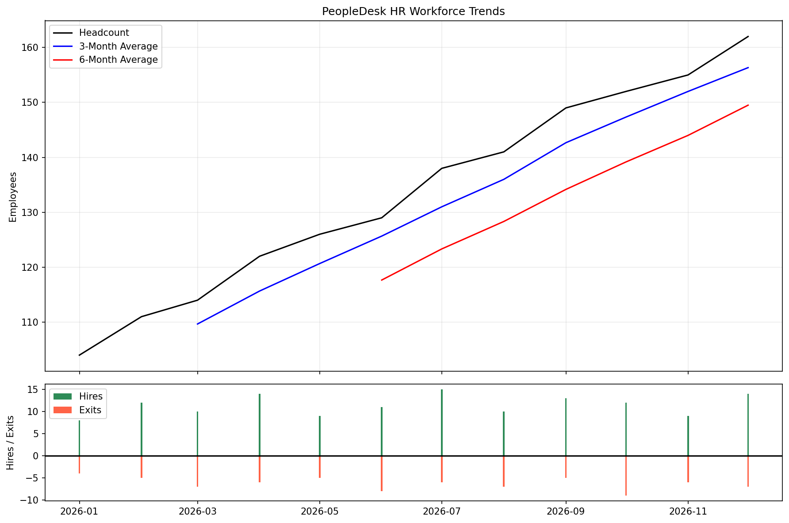
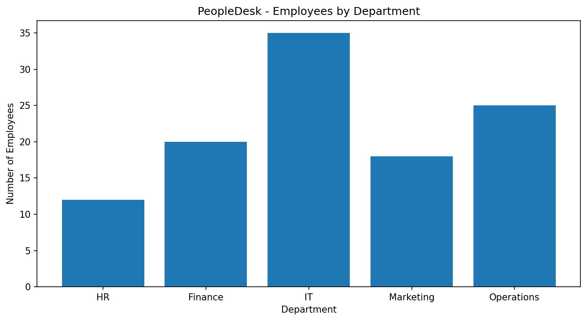

# hr-analytics--peopledesk
# PeopleDesk — HR Analytics Project

## Overview
This project analyzes fictional employee data to understand workforce trends and department-level analytics.

## Objectives
- Track monthly employee headcount
- Analyze hires and exits
- Calculate 3-month and 6-month moving averages
- Compare employee counts across departments
- Calculate department-wise attrition rates

## Tools Used
- Python
- Pandas
- Matplotlib

## Dataset
All employee data used in this project is fictional and created for educational purposes.

## Author
BBA Student | HR Analytics
## Project Visualizations

### 1. Workforce Trends

### 2. Department Analytics

